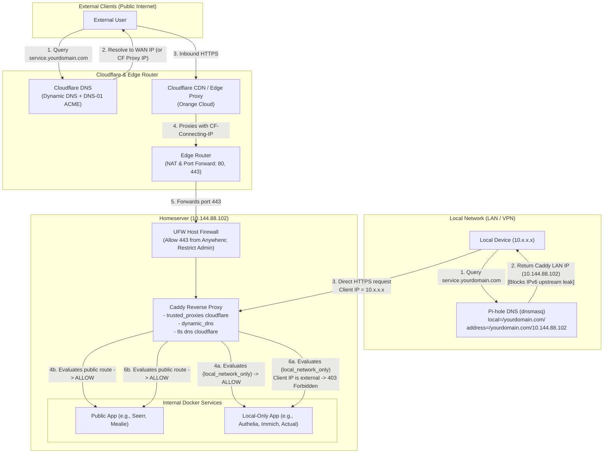

# Integrated Domain Hosting: Cloudflare, Pi-hole, and Caddy

This guide documents the design, configuration, and troubleshooting of a secure, automated, split-horizon hosting architecture using **Cloudflare**, **Pi-hole**, and **Caddy**.

---

## Table of Contents
- [Architecture Overview](#architecture-overview)
  - [The Core Challenge: Split-Horizon DNS & Access Control](#the-core-challenge-split-horizon-dns--access-control)
  - [Request Flow Diagram](#request-flow-diagram)
- [1. Cloudflare Configuration](#1-cloudflare-configuration)
  - [API Token Least-Privilege Scoping](#api-token-least-privilege-scoping)
  - [DNS-01 ACME Challenges (Why It Matters)](#dns-01-acme-challenges-why-it-matters)
  - [Proxying Strategy: Proxied (Orange Cloud) vs. DNS-Only (Grey Cloud)](#proxying-strategy-proxied-orange-cloud-vs-dns-only-grey-cloud)
  - [SSL/TLS Encryption Mode: Full (Strict)](#ssltls-encryption-mode-full-strict)
- [2. Pi-hole: Local DNS & The IPv6 / AAAA Trap](#2-pi-hole-local-dns--the-ipv6--aaaa-trap)
  - [Wildcard Subdomain Routing](#wildcard-subdomain-routing)
  - [The IPv6 / AAAA Leak Trap (The "403 Forbidden" Mystery)](#the-ipv6--aaaa-leak-trap-the-403-forbidden-mystery)
  - [High Availability & Redundancy](#high-availability--redundancy)
- [3. Caddy: Automated Ingress & Reverse Proxy](#3-caddy-automated-ingress--reverse-proxy)
  - [Custom Build with xcaddy](#custom-build-with-xcaddy)
  - [Automating Public DNS with Dynamic DNS](#automating-public-dns-with-dynamic-dns)
  - [Preserving Real Client IPs with Trusted Proxies](#preserving-real-client-ips-with-trusted-proxies)
  - [Reusable Caddy Snippets & Access Control](#reusable-caddy-snippets--access-control)
  - [Secure Secret Management with Docker Secrets](#secure-secret-management-with-docker-secrets)
- [4. Firewall & Defense-in-Depth](#4-firewall--defense-in-depth)
  - [Router Edge Firewall (WAN Ingress)](#router-edge-firewall-wan-ingress)
  - [Host Firewall (UFW)](#host-firewall-ufw)
  - [Defense-in-Depth Layering](#defense-in-depth-layering)
- [5. Verification & Troubleshooting Runbook](#5-verification--troubleshooting-runbook)
  - [Testing Split-Horizon DNS Resolution](#testing-split-horizon-dns-resolution)
  - [Diagnosing 403 Forbidden ACL Rejections](#diagnosing-403-forbidden-acl-rejections)
  - [Verifying Cloudflare Edge IP Preservation](#verifying-cloudflare-edge-ip-preservation)
  - [Checking ACME Certificate Generation Logs](#checking-acme-certificate-generation-logs)

---

## Architecture Overview

### The Core Challenge: Split-Horizon DNS & Access Control

When self-hosting services under a single domain (e.g., `*.yourdomain.com`), you generally want two distinct behaviors:
1. **Public Services** (e.g., media request tools, public web utilities): Accessible from anywhere on the internet via standard HTTPS.
2. **Private/Internal Services** (e.g., identity providers, financial apps, personal dashboards): Accessible **only** when connected to your local network (LAN) or a secure VPN tunnel, returning `403 Forbidden` to external visitors.

To make this work seamlessly with valid SSL/TLS certificates and zero manual DNS maintenance for every new container, three components work in concert:

- **Cloudflare**: Acts as the authoritative public DNS provider, dynamic DNS endpoint, and optional reverse-proxy CDN/DDoS mitigation layer.
- **Pi-hole (dnsmasq)**: Acts as the internal Split-Horizon DNS resolver, intercepting all local queries for `*.yourdomain.com` and steering them directly to Caddy’s LAN IP without looping through the public internet.
- **Caddy**: Serves as the automated reverse proxy. It fetches and renews wildcard/per-domain TLS certificates via Cloudflare DNS-01 challenges, dynamically updates Cloudflare DNS records as new webapps are declared in `Caddyfile`, restores genuine client IPs from Cloudflare proxy headers, and enforces local subnet access control.

### Request Flow Diagram



---

## 1. Cloudflare Configuration

Cloudflare manages your public DNS zone and acts as the validation authority for automated TLS certificates.

### API Token Least-Privilege Scoping

Instead of using a Global API Key, create a dedicated, scoped API token in the **Cloudflare Dashboard** (`My Profile > API Tokens > Create Token`):

- **Template**: *Custom Token*
- **Permissions**:
  - `Zone > DNS > Edit`
  - `Zone > Zone > Read`
- **Zone Resources**:
  - `Include > Specific Zone > yourdomain.com`
- **Client IP Filtering (Optional)**: Can restrict issuance if your WAN IP is static.

> [!IMPORTANT]
> Keep this token secret. In our setup, this token is stored in a Docker secrets file on disk (`${SECRETS_DIR}/caddy_cloudflare_api_token`) and injected via a container entrypoint script so it is never exposed in cleartext Compose manifests.

### DNS-01 ACME Challenges (Why It Matters)

Traditional ACME challenges (HTTP-01) require the Let's Encrypt / ZeroSSL certificate authority to reach your server on **port 80** over the public internet to verify domain ownership.

This causes a major problem for home servers:
- You cannot issue certificates for purely internal services (e.g., `auth.yourdomain.com`, `actual.yourdomain.com`) without opening port 80 to the world.
- If ISP port 80 is blocked, or if an app is internal-only, HTTP-01 challenges fail.

**The Solution: DNS-01 ACME Challenge with Cloudflare**
With the `caddy-dns/cloudflare` module, Caddy speaks directly to Cloudflare's API, temporarily writes a `_acme-challenge` TXT record into your Cloudflare DNS zone, and the certificate authority validates ownership via Cloudflare.

**Advantages**:
- Works even if ports 80/443 are completely blocked or restricted.
- Works seamlessly for internal-only web apps that have no public port exposure.
- Allows automatic provisioning of certificates behind the scenes.

In `Caddyfile`, this is encapsulated in a reusable snippet:

```caddyfile
(cloudflare_dns) {
	tls {
		dns cloudflare {env.CLOUDFLARE_API_TOKEN}
		resolvers 1.1.1.1 1.1.1.2
	}
	import security_headers
}
```

### Proxying Strategy: Proxied (Orange Cloud) vs. DNS-Only (Grey Cloud)

In the Cloudflare dashboard and through dynamic DNS, records can be configured as **Proxied** (Orange Cloud) or **DNS-Only** (Grey Cloud):

| Record Type | Cloudflare Mode | Suitable Services | Why |
| :--- | :--- | :--- | :--- |
| **HTTP / HTTPS Webapps** | **Proxied** (Orange Cloud) | `yourdomain.com`, `mealie.yourdomain.com`, `seerr.yourdomain.com` | Provides edge DDoS mitigation, hides origin WAN IP, and caches static assets. |
| **Non-HTTP TCP / UDP Services** | **DNS-Only** (Grey Cloud) | `minecraft.yourdomain.com`, `wireguard.yourdomain.com` | Standard Cloudflare proxy only supports standard web HTTP/HTTPS ports (80, 443, etc.). Direct TCP/UDP game or VPN traffic (e.g., Minecraft on port 25565 or WireGuard on 51820) will be dropped if proxied. |

### SSL/TLS Encryption Mode: Full (Strict)

In the Cloudflare Dashboard under **SSL/TLS > Overview**:
- **Set to**: `Full (strict)`

> [!WARNING]
> Never use `Flexible`. In `Flexible` mode, Cloudflare communicates with Caddy over unencrypted HTTP (port 80). If Caddy redirects HTTP requests to HTTPS (default behavior), you will cause an infinite `HTTP 301` redirect loop (`ERR_TOO_MANY_REDIRECTS`). `Full (strict)` requires Caddy to present a valid TLS certificate, which it automatically maintains via the Cloudflare DNS-01 plugin.

---

## 2. Pi-hole: Local DNS & The IPv6 / AAAA Trap

Pi-hole acts as the internal network's primary and secondary DNS server. It handles ad-blocking and provides Split-Horizon DNS resolution for your domain.

### Wildcard Subdomain Routing

Instead of manually navigating to Pi-hole's web UI to register an `A` record every single time you add a new Docker container or subdomain, use a custom dnsmasq configuration drop-in file:

**File**: `/etc/dnsmasq.d/99-routing.conf` (mounted into Pi-hole)
```conf
# Keep yourdomain.com and all subdomains local, and disable IPv6 upstream queries
local=/yourdomain.com/

# Wildcard A-record: routes yourdomain.com and all subdomains (*.yourdomain.com) to Caddy LAN IP
address=/yourdomain.com/10.144.88.102
```

- `address=/yourdomain.com/10.144.88.102`: Tells dnsmasq that `yourdomain.com` and any subdomain (`*.yourdomain.com`, such as `auth.yourdomain.com`, `immich.yourdomain.com`, etc.) must resolve immediately to Caddy's internal static IP (`10.144.88.102`).
- Specific overrides (such as SRV records for Minecraft pointing to a different host) can be placed in a separate file (e.g., `10-minecraft-srv.conf`) and will take precedence.

### The IPv6 / AAAA Leak Trap (The "403 Forbidden" Mystery)

One of the most frustrating homelab issues occurs when internal clients access an internal-only web service and intermittently receive a **403 Forbidden** error, even while sitting directly on the home Wi-Fi.

#### What Causes This?
1. Most modern operating systems (macOS, iOS, Windows, Linux, Android) prefer IPv6 (`AAAA` DNS queries) over IPv4 (`A` DNS queries) via the "Happy Eyeballs" algorithm.
2. If your local network runs IPv4-only internally, Pi-hole has a local `A` record for `yourdomain.com`, but **no local `AAAA` record**.
3. By default, when a client queries for the `AAAA` record, Pi-hole forwards the query upstream to Cloudflare.
4. If your domain is configured on Cloudflare, Cloudflare returns public IPv6 edge proxy addresses.
5. The local client connects to Caddy via the public IPv6 address through the router's WAN interface instead of the local IPv4 address.
6. When Caddy inspects the connection with the `local_network_only` rule:
   ```caddyfile
   (local_network_only) {
       @external not remote_ip 10.144.88.0/24 172.19.0.0/16
       respond @external 403 {
           close
       }
   }
   ```
   The source IP is an external IPv6 address, failing the check and triggering an immediate `403 Forbidden`!

#### The Fix:
The line in `99-routing.conf`:
```conf
local=/yourdomain.com/
```
In dnsmasq syntax, `local=/.../` declares that queries matching this domain must **only** be answered locally from dnsmasq or `/etc/hosts`. If no local record exists (such as an `AAAA` record), dnsmasq immediately returns `NODATA` rather than forwarding the query to upstream DNS servers. The client falls back cleanly to the local IPv4 `A` record (`10.144.88.102`).

### High Availability & Redundancy

If your DNS server goes down, your entire local network loses internet and internal routing. Run two instances of Pi-hole:
1. **Primary Pi-hole**: Hosted on your primary NAS / server (e.g., `pihole-nas-compose.yaml`).
2. **Secondary Pi-hole**: Hosted on a separate, lightweight physical device such as a Raspberry Pi (e.g., `pihole-pi-compose.yaml`).

Both instances mount the same `dnsmasq.d/99-routing.conf` file, and your router's DHCP options advertise both IPs as primary and secondary DNS.

---

## 3. Caddy: Automated Ingress & Reverse Proxy

### Custom Build with xcaddy

Stock Caddy does not include Cloudflare DNS, Cloudflare IP lookup, dynamic DNS, or rate limiting out of the box. A multi-stage Docker build with `xcaddy` builds a lightweight, tailored binary:

**`caddy/Dockerfile`**:
```dockerfile
FROM caddy:2-builder-alpine AS builder

RUN <<EOF
xcaddy build \
    --with github.com/mholt/caddy-ratelimit \
    --with github.com/caddy-dns/cloudflare \
    --with github.com/WeidiDeng/caddy-cloudflare-ip \
    --with github.com/mholt/caddy-dynamicdns
EOF

# -----------------

FROM caddy:2-alpine

COPY --from=builder /usr/bin/caddy /usr/bin/caddy
```

### Automating Public DNS with Dynamic DNS

Most home internet connections have dynamic public IPv4 addresses assigned by their ISP. Instead of running a separate container like `ddclient`, the `caddy-dynamicdns` plugin handles this directly in `Caddyfile`:

```caddyfile
dynamic_dns {
	provider cloudflare {env.CLOUDFLARE_API_TOKEN}
	domains {
		yourdomain.com www minecraft
	}
	versions ipv4
	dynamic_domains
}
```

- `versions ipv4`: Disables publishing IPv6 AAAA records if your home network is IPv4-only.
- `dynamic_domains`: Instructs Caddy to scan all defined site blocks throughout the `Caddyfile` and automatically maintain corresponding DNS A records on Cloudflare matching your current public IP!

### Preserving Real Client IPs with Trusted Proxies

When traffic passes through Cloudflare's proxy network, the TCP connection reaching your server originates from a Cloudflare IP address, while the original user's IP is preserved in HTTP headers (`CF-Connecting-IP` and `X-Forwarded-For`).

By default, reverse proxies ignore these headers from untrusted sources to prevent header spoofing. The `caddy-cloudflare-ip` module automatically retrieves Cloudflare’s current CIDR ranges every 12 hours:

```caddyfile
servers {
	trusted_proxies cloudflare {
		interval 12h
		timeout 15s
	}
}
```

This ensures Caddy replaces `{remote_host}` / `{client_ip}` with the visitor's genuine IP address, which is mandatory for:
- Evaluating Caddy ACLs (`local_network_only`).
- Enforcing rate limits per client IP (`rate_limit_api`).
- Accurate logging and fail2ban/CrowdSec inspection.

### Reusable Caddy Snippets & Access Control

Using Caddy snippets keeps the configuration DRY (Don't Repeat Yourself) and makes onboarding new apps effortless:

```caddyfile
# Restrict access to local subnet + Docker bridge network
(local_network_only) {
	@external not remote_ip 10.144.88.0/24 172.19.0.0/16
	respond @external 403 {
		close
	}
}

# Cloudflare DNS-01 TLS challenge & security headers
(cloudflare_dns) {
	tls {
		dns cloudflare {env.CLOUDFLARE_API_TOKEN}
		resolvers 1.1.1.1 1.1.1.2
	}
	import security_headers
}

# Forward authentication via Authelia
(use_authelia) {
	forward_auth authelia:9091 {
		uri /api/authz/forward-auth
		copy_headers Remote-User Remote-Groups Remote-Name Remote-Email
	}
}
```

#### Example Usage:
```caddyfile
# Public Service: Accessible from WAN, Rate-limited
mealie.yourdomain.com {
	import cloudflare_dns
	import rate_limit_api "/api/*"
	reverse_proxy mealie:9000
}

# Private Service: Local-only + SSO MFA
lubelogger.yourdomain.com {
	import use_authelia
	import cloudflare_dns
	import local_network_only
	reverse_proxy lubelogger:8080
}
```

### Secure Secret Management with Docker Secrets

Avoid putting API tokens in environment variables or configuration files checked into source control. Mount the token as a Docker secret in `caddy-compose.yaml`:

```yaml
secrets:
  cloudflare_api_token:
    file: ${SECRETS_DIR}/caddy_cloudflare_api_token

services:
  caddy:
    entrypoint:
      [
        "/docker-entrypoint.sh",
        "caddy",
        "run",
        "--config",
        "/etc/caddy/Caddyfile",
      ]
    volumes:
      - ${SCRIPTS_DIR}/set_secret_vars.sh:/docker-entrypoint.sh
    secrets:
      - cloudflare_api_token
```

The `set_secret_vars.sh` entrypoint script reads `/run/secrets/cloudflare_api_token`, sets `CLOUDFLARE_API_TOKEN` in the environment of the running process, and executes `caddy run`.

---

## 4. Firewall & Defense-in-Depth

A key principle in self-hosting is **Defense-in-Depth**: security should not rely on a single layer.

### Router Edge Firewall (WAN Ingress)

The router is your first perimeter defense. Configure your router firewall according to these principles:

1. **Default Policy**: **Deny All** unsolicited inbound WAN traffic.
2. **Minimal Port Forwarding**:
   - Forward **only** TCP port `443` (and optionally port `80` for ACME HTTP-01 fallback / HTTP-to-HTTPS redirects) to Caddy's internal static IP (`10.144.88.102`).
   - Forward dedicated ports only for services that cannot run behind reverse proxies:
     - Game servers (e.g., Minecraft TCP `25565`).
     - VPN tunnels (e.g., WireGuard UDP `51820`).
     - Direct media streams (e.g., Plex TCP `32400`).
3. **Internal Application Ports Must Never Be Forwarded**:
   - Ports for management panels (Authelia `9091`, Uptime Kuma `3001`, Dozzle, Pi-hole admin `8000/8001`, Portainer, databases) must **never** be forwarded on the router. They are only reachable locally via Caddy reverse proxy or LAN.
4. **Geo-IP Filtering (Optional)**: If supported by your router (e.g., Synology SRM), restrict inbound forwarding on HTTP/HTTPS ports to countries where you or your trusted users reside.

### Host Firewall (UFW)

On the server host running Docker, enforce a host-level firewall (`sudo ufw status numbered`):

```bash
# Allow HTTPS reverse proxy traffic
sudo ufw allow 443/tcp comment "Allow HTTPS traffic"

# Allow SSH administration ONLY from the trusted local subnet or VPN IP
sudo ufw allow from <LAN_SUBNET_CIDR> to any port <SSH_PORT> proto tcp comment "LAN SSH only"

# Allow specific gaming/media ports as needed
sudo ufw allow 25565/tcp comment "Minecraft"
sudo ufw allow 32400/tcp comment "Plex"

# Deny legacy / dangerous ports
sudo ufw deny 631/tcp comment "Disable printing port"

# Default rules
sudo ufw default deny incoming
sudo ufw default allow outgoing
```

> [!NOTE]
> **Docker and UFW Interaction**: By default, Docker manipulates `iptables` directly, which can bypass UFW rules for published container ports (`ports: - "host:container"`). By attaching internal containers to an internal Docker bridge network (`webapps`) without publishing their internal ports to the host interface, only Caddy can reach them.

### Defense-in-Depth Layering

| Layer | Component | Function |
| :--- | :--- | :--- |
| **Layer 1: Edge Router** | Router Firewall / NAT | Drops all unforwarded ports; only permits 80, 443, and dedicated game/VPN ports. |
| **Layer 2: Host Firewall** | UFW | Restricts host management ports (SSH, remote streaming, admin interfaces) to the LAN subnet. |
| **Layer 3: Reverse Proxy** | Caddy `local_network_only` | Inspects client IP on every HTTP request; rejects external traffic for private apps with `403 Forbidden`. |
| **Layer 4: Authentication** | Authelia (Forward Auth) | Enforces Multi-Factor Authentication (MFA) before users can view internal apps. |
| **Layer 5: Application** | Native App Auth | Service-level credentials and session management. |

---

## 5. Verification & Troubleshooting Runbook

### Testing Split-Horizon DNS Resolution

Verify that LAN devices resolve your subdomains locally, while public DNS resolvers resolve them to your WAN or Cloudflare proxy IP.

**From a device on your local LAN / Wi-Fi**:
```bash
# Query your local Pi-hole instance
nslookup auth.yourdomain.com <PIHOLE_LAN_IP>
```
*Expected output*: Resolves to Caddy's LAN IP (`10.144.88.102`).

**From an external network (or testing against public DNS)**:
```bash
# Query upstream public resolver directly
nslookup auth.yourdomain.com 1.1.1.1
```
*Expected output*: Resolves to your public WAN IP (or Cloudflare Edge Proxy IP).

### Diagnosing 403 Forbidden ACL Rejections

If you receive an unexpected `403 Forbidden` while connected to the local network:

1. **Check for IPv6 resolution**:
   ```bash
   dig AAAA auth.yourdomain.com @<PIHOLE_LAN_IP>
   ```
   *If an IPv6 address is returned*, verify that `/etc/dnsmasq.d/99-routing.conf` contains `local=/yourdomain.com/` and restart the Pi-hole FTL service (`docker restart pihole`).
2. **Inspect Caddy logs to view the evaluated client IP**:
   Check the application log (e.g., `/var/log/caddy/authelia.log`):
   ```bash
   docker exec -it caddy cat /var/log/caddy/authelia.log | jq .
   ```
   Inspect the `"remote_ip"` and `"client_ip"` fields. If the IP starts with something other than your LAN subnet (`10.144.88.x` or Docker subnet `172.19.x.x`), Caddy properly blocked an external address.

### Verifying Cloudflare Edge IP Preservation

To verify that Caddy is restoring genuine visitor IPs rather than logging Cloudflare proxy IPs:
1. Access a public app (e.g., `mealie.yourdomain.com`) from a cellular network (disconnect from home Wi-Fi).
2. Check Caddy's access log for Mealie.
3. Verify that the recorded `client_ip` matches your phone's cellular public IP rather than a Cloudflare IP (`173.245.x.x`, `103.21.x.x`, etc.). If it shows a Cloudflare IP, ensure `trusted_proxies cloudflare` is declared in global options.

### Checking ACME Certificate Generation Logs

If Caddy fails to obtain certificates via Cloudflare:
```bash
docker logs caddy --tail 100 | grep -i tls
```
- **Error: `unauthorized (401)`**: Check that the API token in `${SECRETS_DIR}/caddy_cloudflare_api_token` has `Zone.DNS:Edit` and `Zone.Zone:Read` permissions.
- **Error: `SERVFAIL` during DNS-01 challenge**: Ensure the authoritative nameservers for your domain in Cloudflare are active and that no firewalls block outbound UDP/TCP port 53 queries from Caddy to Cloudflare resolvers `1.1.1.1`.
